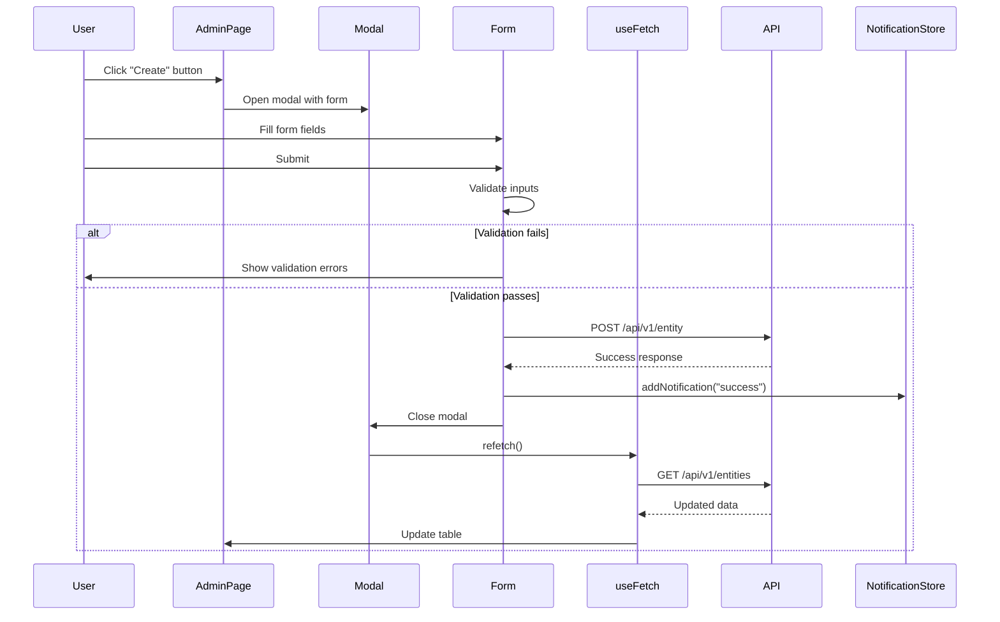
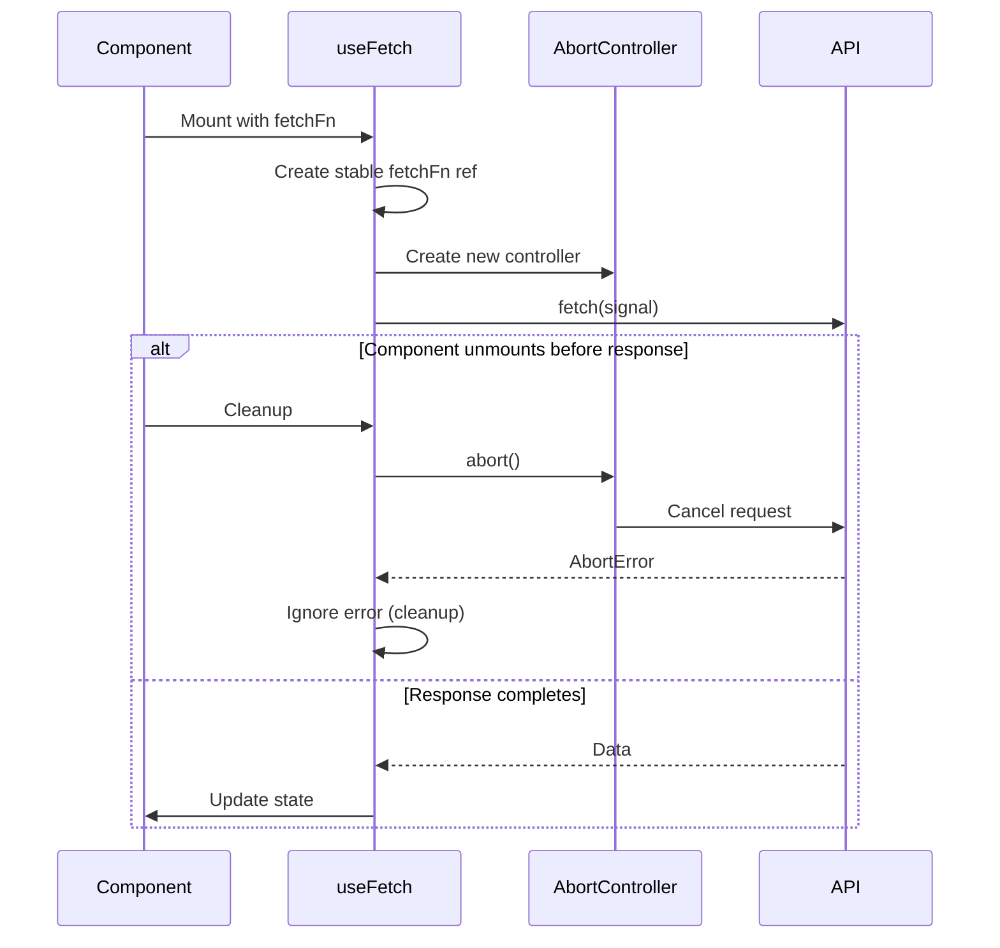

# Design Document: Frontend Fixes and Improvements

## Overview

This design addresses critical issues and missing functionality in the Teligram UI frontend project, a Next.js 16.2.4 + React 19 + TypeScript poetry kiosk system. The project consists of two main interfaces: a public kiosk view for browsing poetry collections and an admin interface for managing booths, collections, poets, and poems. The backend API is at http://127.0.0.1:8000/api/v1.

The design focuses on seven key areas: environment configuration, complete CRUD operations for all entities, fixing the useFetch hook's infinite re-render issue, creating missing reusable components (forms, modals, error boundaries), implementing poem sorting, and adding comprehensive error handling with user notifications. All changes are frontend-only and maintain the existing tech stack (Next.js 16, React 19, TypeScript, Tailwind CSS, Zustand).

## Architecture

```mermaid
graph TD
    A[Root Layout] --> B[AppProviders]
    B --> C[NotificationProvider]
    B --> D[ErrorBoundary]
    D --> E[Admin Layout]
    D --> F[Kiosk Layout]
    
    E --> G[Booths Page]
    E --> H[Collections Page]
    E --> I[Poets Page]
    E --> J[Poems Page]
    
    G --> K[Modal Components]
    H --> K
    I --> K
    J --> K
    
    K --> L[Form Components]
    K --> M[ConfirmDialog]
    
    G --> N[useFetch Hook]
    H --> N
    I --> N
    J --> N
    
    N --> O[API Client]
    O --> P[Backend API]
    
    style C fill:#e1f5e1
    style D fill:#ffe1e1
    style K fill:#e1e5ff
    style N fill:#fff4e1
```



## Sequence Diagrams

### Admin CRUD Operation Flow



### useFetch Hook Lifecycle with AbortController



## Components and Interfaces

### 1. Modal Component

**Purpose**: Reusable modal dialog for forms and confirmations

**Interface**:
```typescript
interface ModalProps {
  isOpen: boolean;
  onClose: () => void;
  title: string;
  children: React.ReactNode;
  size?: "sm" | "md" | "lg";
}

export const Modal: React.FC<ModalProps>
```

**Responsibilities**:
- Render overlay and centered dialog
- Handle ESC key to close
- Prevent body scroll when open
- Focus trap within modal
- ARIA attributes for accessibility

### 2. ConfirmDialog Component

**Purpose**: Confirmation dialog for destructive actions

**Interface**:
```typescript
interface ConfirmDialogProps {
  isOpen: boolean;
  onClose: () => void;
  onConfirm: () => void | Promise<void>;
  title: string;
  message: string;
  confirmText?: string;
  cancelText?: string;
  variant?: "danger" | "warning";
  loading?: boolean;
}

export const ConfirmDialog: React.FC<ConfirmDialogProps>
```

**Responsibilities**:
- Display confirmation message
- Handle async confirm actions
- Show loading state during operation
- Prevent double-submission
- Color-coded by variant (red for danger)

### 3. Form Components

**Purpose**: Reusable form input components with validation

**Interfaces**:
```typescript
interface InputProps extends React.InputHTMLAttributes<HTMLInputElement> {
  label: string;
  error?: string;
  required?: boolean;
}

interface TextareaProps extends React.TextareaHTMLAttributes<HTMLTextAreaElement> {
  label: string;
  error?: string;
  required?: boolean;
}

interface SelectProps extends React.SelectHTMLAttributes<HTMLSelectElement> {
  label: string;
  error?: string;
  required?: boolean;
  options: Array<{ value: string; label: string }>;
}

interface ButtonProps extends React.ButtonHTMLAttributes<HTMLButtonElement> {
  variant?: "primary" | "secondary" | "danger";
  loading?: boolean;
  fullWidth?: boolean;
}

export const Input: React.FC<InputProps>
export const Textarea: React.FC<TextareaProps>
export const Select: React.FC<SelectProps>
export const Button: React.FC<Button Props>
```

**Responsibilities**:
- Consistent styling across forms
- Display validation errors
- Handle loading states
- Accessibility labels and ARIA attributes
- Native HTML5 validation support

### 4. ErrorBoundary Component

**Purpose**: Catch and display React errors gracefully

**Interface**:
```typescript
interface ErrorBoundaryProps {
  children: React.ReactNode;
  fallback?: React.ReactNode;
}

interface ErrorBoundaryState {
  hasError: boolean;
  error: Error | null;
}

export class ErrorBoundary extends React.Component<ErrorBoundaryProps, ErrorBoundaryState>
```

**Responsibilities**:
- Catch rendering errors in child components
- Display user-friendly error message
- Provide "Try Again" action
- Log errors to console (future: send to monitoring service)
- Prevent entire app crash

### 5. Entity Form Components

**Purpose**: Specific forms for creating/editing each entity type

**Interfaces**:
```typescript
interface BoothFormProps {
  initialData?: Partial<Booth>;
  onSubmit: (data: CreateBoothRequest) => Promise<void>;
  onCancel: () => void;
}

interface CollectionFormProps {
  initialData?: Partial<Collection>;
  onSubmit: (data: CreateCollectionRequest) => Promise<void>;
  onCancel: () => void;
}

interface PoetFormProps {
  initialData?: Partial<Poet>;
  onSubmit: (data: CreatePoetRequest) => Promise<void>;
  onCancel: () => void;
}

interface PoemFormProps {
  initialData?: Partial<Poem>;
  collections: Collection[];
  poets: Poet[];
  onSubmit: (data: CreatePoemRequest) => Promise<void>;
  onCancel: () => void;
}

export const BoothForm: React.FC<BoothFormProps>
export const CollectionForm: React.FC<CollectionFormProps>
export const PoetForm: React.FC<PoetFormProps>
export const PoemForm: React.FC<PoemFormProps>
```

**Responsibilities**:
- Handle form state and validation
- Support both create and edit modes
- Display loading state during submission
- Show validation errors inline
- Call onSubmit with validated data

## Data Models

### Environment Configuration

```typescript
// .env.local
interface EnvironmentVariables {
  NEXT_PUBLIC_API_URL: string; // Default: "http://127.0.0.1:8000/api/v1"
}
```

**Validation Rules**:
- NEXT_PUBLIC_API_URL must be a valid URL
- Must start with http:// or https://
- No trailing slash

### Form Validation Rules

#### Booth Form
```typescript
interface BoothFormValidation {
  location: {
    required: true;
    minLength: 2;
    maxLength: 100;
  };
  theme: {
    required: true;
    minLength: 2;
    maxLength: 200;
  };
}
```

#### Collection Form
```typescript
interface CollectionFormValidation {
  name: {
    required: true;
    minLength: 2;
    maxLength: 100;
    unique: true; // Validated by backend
  };
}
```

#### Poet Form
```typescript
interface PoetFormValidation {
  name: {
    required: true;
    minLength: 2;
    maxLength: 100;
  };
  bio: {
    required: false;
    maxLength: 2000;
  };
  image: {
    required: false;
    pattern: /^https?:\/\/.+/; // Valid URL
  };
}
```

#### Poem Form
```typescript
interface PoemFormValidation {
  name: {
    required: true;
    minLength: 2;
    maxLength: 200;
  };
  text: {
    required: true;
    minLength: 10;
    maxLength: 10000;
  };
  collection_id: {
    required: true;
    format: "uuid";
  };
  poet_id: {
    required: true;
    format: "uuid";
  };
  poemNo: {
    required: true;
    type: "number";
    min: 1;
    unique: true; // Within collection, validated by backend
  };
  description: {
    required: false;
    maxLength: 1000;
  };
  audio: {
    required: false;
    pattern: /^https?:\/\/.+/;
  };
  image: {
    required: false;
    pattern: /^https?:\/\/.+/;
  };
}
```

## Algorithmic Pseudocode

### Fixed useFetch Hook Algorithm

```typescript
/**
 * Custom hook for data fetching with proper cleanup and dependency management
 * 
 * Preconditions:
 * - fetchFn is a function that returns a Promise<T>
 * - options.skip is optional boolean
 * - options.refetchInterval is optional number in milliseconds
 * 
 * Postconditions:
 * - Returns object with data, loading, error, and refetch function
 * - Properly cleans up on unmount
 * - No infinite re-render loops
 * - Aborts in-flight requests on cleanup
 */
function useFetch<T>(
  fetchFn: () => Promise<T>,
  options?: { skip?: boolean; refetchInterval?: number }
): UseFetchResult<T> {
  // State initialization
  const [data, setData] = useState<T | null>(null);
  const [loading, setLoading] = useState(!options?.skip);
  const [error, setError] = useState<string | null>(null);
  
  // Create stable reference to fetchFn to prevent infinite loops
  const fetchFnRef = useRef(fetchFn);
  
  // Update ref when fetchFn changes (but don't trigger re-fetch)
  useEffect(() => {
    fetchFnRef.current = fetchFn;
  }, [fetchFn]);
  
  // Main fetch function with AbortController
  const run = useCallback(async () => {
    if (options?.skip) return;
    
    const abortController = new AbortController();
    setLoading(true);
    setError(null);
    
    try {
      // Call current fetchFn from ref
      const result = await fetchFnRef.current();
      
      // Only update state if not aborted
      if (!abortController.signal.aborted) {
        setData(result);
      }
    } catch (err) {
      // Ignore abort errors
      if (err instanceof Error && err.name === "AbortError") {
        return;
      }
      
      if (!abortController.signal.aborted) {
        setError(getErrorMessage(err));
      }
    } finally {
      if (!abortController.signal.aborted) {
        setLoading(false);
      }
    }
    
    return () => abortController.abort();
  }, [options?.skip]);
  
  // Effect for initial fetch and refetch interval
  useEffect(() => {
    const cleanup = run();
    
    // Setup interval if specified
    if (options?.refetchInterval) {
      const timer = setInterval(() => void run(), options.refetchInterval);
      return () => {
        clearInterval(timer);
        cleanup?.then(fn => fn?.());
      };
    }
    
    return () => cleanup?.then(fn => fn?.());
  }, [run, options?.refetchInterval]);
  
  return { data, loading, error, refetch: run };
}
```

**Loop Invariants**:
- fetchFnRef.current always points to the latest fetchFn
- AbortController is created fresh for each request
- State updates only occur if request not aborted

### Poem Sorting Algorithm

```typescript
/**
 * Sort poems by poemNo in ascending order
 * 
 * Preconditions:
 * - poems is an array of Poem objects
 * - Each poem has a poemNo property of type number
 * 
 * Postconditions:
 * - Returns new array sorted by poemNo ascending
 * - Original array is not mutated
 * - Stable sort (poems with same poemNo maintain relative order)
 */
function sortPoemsByNumber(poems: Poem[]): Poem[] {
  return [...poems].sort((a, b) => a.poemNo - b.poemNo);
}

/**
 * Apply to collection poems API response
 */
async function getCollectionPoems(collectionId: string): Promise<Poem[]> {
  const poems = await apiClient.get<Poem[]>(
    API_ENDPOINTS.collectionPoems(collectionId)
  );
  return sortPoemsByNumber(poems);
}
```

### Form Validation Algorithm

```typescript
/**
 * Validate form data against validation rules
 * 
 * Preconditions:
 * - formData is an object with string keys
 * - validationRules defines constraints for each field
 * 
 * Postconditions:
 * - Returns object with field names as keys and error messages as values
 * - Empty object if no errors
 * - All required fields are checked
 */
function validateForm<T extends Record<string, unknown>>(
  formData: T,
  validationRules: ValidationRules<T>
): ValidationErrors {
  const errors: ValidationErrors = {};
  
  for (const [field, rules] of Object.entries(validationRules)) {
    const value = formData[field];
    
    // Check required
    if (rules.required && !value) {
      errors[field] = `${field} is required`;
      continue;
    }
    
    // Skip further validation if empty and not required
    if (!value) continue;
    
    // Check string length
    if (typeof value === "string") {
      if (rules.minLength && value.length < rules.minLength) {
        errors[field] = `Minimum length is ${rules.minLength}`;
        continue;
      }
      if (rules.maxLength && value.length > rules.maxLength) {
        errors[field] = `Maximum length is ${rules.maxLength}`;
        continue;
      }
      if (rules.pattern && !rules.pattern.test(value)) {
        errors[field] = `Invalid format`;
        continue;
      }
    }
    
    // Check number constraints
    if (typeof value === "number") {
      if (rules.min !== undefined && value < rules.min) {
        errors[field] = `Minimum value is ${rules.min}`;
        continue;
      }
      if (rules.max !== undefined && value > rules.max) {
        errors[field] = `Maximum value is ${rules.max}`;
        continue;
      }
    }
  }
  
  return errors;
}
```

**Loop Invariants**:
- All previously validated fields have either passed or have error recorded
- Validation stops at first error per field (early termination)
- errors object only contains fields with validation failures

### CRUD Operation with Notification Algorithm

```typescript
/**
 * Generic CRUD operation handler with loading state and notifications
 * 
 * Preconditions:
 * - operation is an async function that performs the API call
 * - successMessage is a string to display on success
 * - onSuccess is optional callback to run after successful operation
 * 
 * Postconditions:
 * - Shows loading state during operation
 * - Displays success notification on completion
 * - Displays error notification on failure
 * - Calls onSuccess callback if provided
 * - Always resets loading state
 */
async function handleCRUDOperation<T>(
  operation: () => Promise<T>,
  successMessage: string,
  onSuccess?: (result: T) => void
): Promise<void> {
  const { addNotification } = useNotificationStore.getState();
  
  try {
    // Execute operation
    const result = await operation();
    
    // Show success notification
    addNotification(successMessage, "success");
    
    // Call success callback if provided
    if (onSuccess) {
      onSuccess(result);
    }
  } catch (error) {
    // Show error notification
    const errorMessage = getErrorMessage(error);
    addNotification(errorMessage, "error");
    
    // Re-throw to allow caller to handle if needed
    throw error;
  }
}

/**
 * Example usage in admin page
 */
async function handleCreateBooth(data: CreateBoothRequest) {
  await handleCRUDOperation(
    () => boothAPI.create(data),
    "Booth created successfully",
    () => {
      closeModal();
      refetch();
    }
  );
}
```

## Key Functions with Formal Specifications

### Function 1: Modal.open()

```typescript
function openModal(modalId: string): void
```

**Preconditions:**
- modalId is a non-empty string
- Modal component is mounted in the DOM

**Postconditions:**
- Modal with matching ID is visible
- Body scroll is disabled
- Focus is trapped within modal
- ESC key listener is attached
- Overlay click listener is attached

**Loop Invariants:** N/A

### Function 2: ConfirmDialog.onConfirm()

```typescript
async function handleConfirm(): Promise<void>
```

**Preconditions:**
- onConfirm prop is a valid function
- Dialog is open
- Not already in loading state

**Postconditions:**
- Loading state is set to true during execution
- onConfirm function is called exactly once
- Loading state is reset after completion
- Dialog closes on success
- Error is displayed on failure
- No double-submission possible

**Loop Invariants:** N/A

### Function 3: ErrorBoundary.componentDidCatch()

```typescript
function componentDidCatch(error: Error, errorInfo: React.ErrorInfo): void
```

**Preconditions:**
- Error occurred in child component tree
- ErrorBoundary is mounted

**Postconditions:**
- Error is logged to console
- hasError state is set to true
- error state contains the Error object
- Fallback UI is rendered
- Child components are unmounted
- Error does not propagate to parent

**Loop Invariants:** N/A

### Function 4: validateForm()

```typescript
function validateForm<T>(data: T, rules: ValidationRules<T>): ValidationErrors
```

**Preconditions:**
- data is a non-null object
- rules is a valid ValidationRules object
- All rule properties are valid constraint types

**Postconditions:**
- Returns object with field names as keys
- Each value is an error message string
- Empty object if all validations pass
- All required fields are validated
- No mutations to input data

**Loop Invariants:**
- All previously checked fields have been validated
- errors object only contains fields that failed validation

### Function 5: sortPoemsByNumber()

```typescript
function sortPoemsByNumber(poems: Poem[]): Poem[]
```

**Preconditions:**
- poems is an array (may be empty)
- Each poem has a poemNo property of type number

**Postconditions:**
- Returns new array (original not mutated)
- Array is sorted by poemNo in ascending order
- Stable sort maintained
- All poems from input are in output
- Length of output equals length of input

**Loop Invariants:**
- For sorted portion: poems[i].poemNo <= poems[i+1].poemNo

## Example Usage

### Creating a Booth

```typescript
// Admin Booths Page
function AdminBoothsPage() {
  const [isModalOpen, setIsModalOpen] = useState(false);
  const { data, loading, error, refetch } = useFetch(boothAPI.getAll);
  const { addNotification } = useNotificationStore();
  
  const handleCreate = async (formData: CreateBoothRequest) => {
    try {
      await boothAPI.create(formData);
      addNotification("Booth created successfully", "success");
      setIsModalOpen(false);
      refetch();
    } catch (err) {
      addNotification(getErrorMessage(err), "error");
    }
  };
  
  return (
    <>
      <Button onClick={() => setIsModalOpen(true)}>Create Booth</Button>
      
      <Modal
        isOpen={isModalOpen}
        onClose={() => setIsModalOpen(false)}
        title="Create Booth"
      >
        <BoothForm
          onSubmit={handleCreate}
          onCancel={() => setIsModalOpen(false)}
        />
      </Modal>
      
      {/* Table rendering */}
    </>
  );
}
```

### Deleting with Confirmation

```typescript
function AdminBoothsPage() {
  const [deleteTarget, setDeleteTarget] = useState<string | null>(null);
  const [isDeleting, setIsDeleting] = useState(false);
  
  const handleDelete = async () => {
    if (!deleteTarget) return;
    
    setIsDeleting(true);
    try {
      await boothAPI.remove(deleteTarget);
      addNotification("Booth deleted successfully", "success");
      setDeleteTarget(null);
      refetch();
    } catch (err) {
      addNotification(getErrorMessage(err), "error");
    } finally {
      setIsDeleting(false);
    }
  };
  
  return (
    <>
      <Button
        variant="danger"
        onClick={() => setDeleteTarget(booth.id)}
      >
        Delete
      </Button>
      
      <ConfirmDialog
        isOpen={deleteTarget !== null}
        onClose={() => setDeleteTarget(null)}
        onConfirm={handleDelete}
        title="Delete Booth"
        message="Are you sure you want to delete this booth? This action cannot be undone."
        variant="danger"
        loading={isDeleting}
      />
    </>
  );
}
```

### Using Fixed useFetch Hook

```typescript
// Component using useFetch
function MyComponent() {
  // fetchFn is stable - no infinite loop
  const { data, loading, error, refetch } = useFetch(
    () => boothAPI.getAll(),
    { refetchInterval: 30000 }
  );
  
  // Cleanup happens automatically on unmount
  // AbortController cancels in-flight requests
  
  return <div>{/* render data */}</div>;
}
```

### Sorting Poems in Collection

```typescript
// Collection Poems Page
function CollectionPoemsPage({ collectionId }: Props) {
  const { data, loading, error } = useFetch(
    () => collectionAPI.getPoems(collectionId)
  );
  
  // Poems are automatically sorted by poemNo
  const sortedPoems = data ? sortPoemsByNumber(data) : [];
  
  return (
    <div>
      {sortedPoems.map(poem => (
        <PoemCard key={poem.id} poem={poem} />
      ))}
    </div>
  );
}
```

## Correctness Properties

### Property 1: No Infinite Re-renders
```typescript
// For all components using useFetch:
// ∀ component C, ∀ time t:
//   renderCount(C, t) < ∞
//   ∧ fetchFn changes → no automatic re-fetch
//   ∧ only explicit refetch() or interval triggers fetch
```

### Property 2: Request Cleanup
```typescript
// For all useFetch instances:
// ∀ fetch F, unmount event U:
//   U occurs before F completes → F is aborted
//   ∧ no state updates after abort
//   ∧ no memory leaks
```

### Property 3: Form Validation Completeness
```typescript
// For all form submissions:
// ∀ form F, submission S:
//   S occurs → all required fields validated
//   ∧ validation fails → submission prevented
//   ∧ validation passes → API call made
//   ∧ errors displayed inline
```

### Property 4: Poem Ordering
```typescript
// For all collection poem lists:
// ∀ collection C, poems P:
//   display(P) → sorted by poemNo ascending
//   ∧ ∀ i ∈ [0, P.length-2]: P[i].poemNo ≤ P[i+1].poemNo
```

### Property 5: Notification Consistency
```typescript
// For all CRUD operations:
// ∀ operation O:
//   O succeeds → success notification shown
//   ∧ O fails → error notification shown
//   ∧ notification auto-dismisses after timeout
//   ∧ user can manually dismiss
```

### Property 6: Modal Focus Trap
```typescript
// For all open modals:
// ∀ modal M, M.isOpen = true:
//   Tab key → focus cycles within M
//   ∧ focus never escapes M
//   ∧ ESC key → M closes
//   ∧ overlay click → M closes
```

### Property 7: Error Boundary Isolation
```typescript
// For all error boundaries:
// ∀ error E in child component C:
//   E occurs → boundary catches E
//   ∧ fallback UI rendered
//   ∧ E does not crash parent
//   ∧ sibling components unaffected
```

### Property 8: Data Consistency After CRUD
```typescript
// For all CRUD operations:
// ∀ operation O (create/update/delete):
//   O completes successfully → refetch() called
//   ∧ UI reflects latest server state
//   ∧ no stale data displayed
```

## Error Handling

### Error Scenario 1: API Request Failure

**Condition**: Network error, server error (5xx), or API returns error response
**Response**: 
- Catch error in API client
- Extract error message from response or use generic message
- Display error notification to user
- Keep form data intact (don't clear on error)
- Provide retry mechanism

**Recovery**:
- User can retry the operation
- User can modify data and resubmit
- Error notification auto-dismisses after 5 seconds

### Error Scenario 2: Validation Failure

**Condition**: Form data fails client-side validation
**Response**:
- Prevent form submission
- Display inline error messages below each invalid field
- Highlight invalid fields with red border
- Focus first invalid field
- Keep submit button enabled for retry

**Recovery**:
- User corrects invalid fields
- Validation runs on blur and on submit
- Errors clear when field becomes valid

### Error Scenario 3: Duplicate Entity

**Condition**: Backend returns 409 Conflict (e.g., collection name already exists)
**Response**:
- Display error notification with specific message
- Highlight the conflicting field
- Keep modal open with data intact
- Suggest alternative (e.g., "Collection 'Sufism' already exists. Try a different name.")

**Recovery**:
- User modifies the conflicting field
- User can resubmit with new value

### Error Scenario 4: Component Render Error

**Condition**: JavaScript error during component rendering
**Response**:
- ErrorBoundary catches the error
- Log error to console with stack trace
- Display fallback UI with error message
- Provide "Try Again" button to reset boundary
- Prevent error from crashing entire app

**Recovery**:
- User clicks "Try Again" to reset error boundary
- User navigates to different page
- Error is logged for debugging

### Error Scenario 5: Unauthorized/Forbidden

**Condition**: API returns 401 or 403 status
**Response**:
- Display error notification
- Log user out if 401
- Redirect to login page
- Clear any sensitive data from state

**Recovery**:
- User logs in again
- User contacts administrator for permissions

### Error Scenario 6: Not Found (404)

**Condition**: Requested entity does not exist
**Response**:
- Display error notification
- Show empty state in UI
- Provide navigation back to list view
- Remove invalid ID from URL

**Recovery**:
- User navigates back to list
- User selects different entity

## Testing Strategy

### Unit Testing Approach

**Test Coverage Goals**: 80% code coverage for utility functions, hooks, and components

**Key Test Cases**:

1. **useFetch Hook**
   - Test successful data fetch
   - Test error handling
   - Test loading states
   - Test refetch functionality
   - Test cleanup on unmount
   - Test AbortController cancellation
   - Test skip option
   - Test refetch interval

2. **Form Validation**
   - Test required field validation
   - Test min/max length validation
   - Test pattern matching (URLs)
   - Test number constraints
   - Test empty form submission
   - Test partial validation

3. **Poem Sorting**
   - Test sorting empty array
   - Test sorting single poem
   - Test sorting multiple poems
   - Test stable sort
   - Test original array not mutated

4. **Modal Component**
   - Test open/close functionality
   - Test ESC key closes modal
   - Test overlay click closes modal
   - Test focus trap
   - Test body scroll lock

5. **ConfirmDialog**
   - Test confirm action
   - Test cancel action
   - Test loading state
   - Test prevent double-submission
   - Test async confirm handler

6. **ErrorBoundary**
   - Test error catching
   - Test fallback UI rendering
   - Test error logging
   - Test reset functionality

### Property-Based Testing Approach

**Property Test Library**: fast-check (for TypeScript/JavaScript)

**Properties to Test**:

1. **Poem Sorting Property**
   ```typescript
   // Property: Sorted array is always ordered by poemNo
   fc.assert(
     fc.property(fc.array(poemArbitrary), (poems) => {
       const sorted = sortPoemsByNumber(poems);
       return isSortedByPoemNo(sorted);
     })
   );
   ```

2. **Form Validation Property**
   ```typescript
   // Property: Invalid data always produces errors
   fc.assert(
     fc.property(invalidFormDataArbitrary, (data) => {
       const errors = validateForm(data, rules);
       return Object.keys(errors).length > 0;
     })
   );
   ```

3. **useFetch Cleanup Property**
   ```typescript
   // Property: Unmounting always cleans up
   fc.assert(
     fc.property(fc.func(fc.anything()), (fetchFn) => {
       const { unmount } = renderHook(() => useFetch(fetchFn));
       unmount();
       // Assert no memory leaks, no pending timers
       return jest.getTimerCount() === 0;
     })
   );
   ```

### Integration Testing Approach

**Integration Test Scenarios**:

1. **Complete CRUD Flow**
   - Create entity → verify in list
   - Edit entity → verify changes
   - Delete entity → verify removed
   - Test with all entity types

2. **Form Submission Flow**
   - Open modal → fill form → submit → verify notification → verify modal closes → verify data refetched

3. **Error Recovery Flow**
   - Trigger API error → verify error notification → retry → verify success

4. **Booth-Collection Linking**
   - Link booth to collection → verify in both views
   - Unlink → verify removed from both views

5. **Poem Ordering in Collection**
   - Create poems with different poemNo values
   - Verify display order matches poemNo order
   - Update poemNo → verify re-ordering

## Performance Considerations

### Optimization 1: Debounced Validation
- Debounce form validation on input change (300ms)
- Validate immediately on blur
- Prevent excessive validation calls during typing

### Optimization 2: Memoized Sorted Lists
- Use useMemo for sorted poem lists
- Only re-sort when data changes
- Prevent unnecessary sorting on every render

### Optimization 3: Modal Lazy Rendering
- Only render modal content when isOpen = true
- Unmount modal content when closed
- Reduce memory footprint

### Optimization 4: Optimistic UI Updates
- Update UI immediately on successful operation
- Revert on error
- Improve perceived performance

### Optimization 5: Request Deduplication
- Cache GET requests for short duration (30s)
- Prevent duplicate simultaneous requests
- Use SWR pattern for data fetching

## Security Considerations

### Security 1: XSS Prevention
- All user input is rendered via React (automatic escaping)
- No dangerouslySetInnerHTML usage
- Sanitize URLs before rendering in href attributes

### Security 2: CSRF Protection
- API uses JSON content-type (not form-encoded)
- Future: Add CSRF tokens for state-changing operations
- Use SameSite cookies if authentication added

### Security 3: Input Validation
- Client-side validation for UX
- Server-side validation is source of truth
- Never trust client-side validation alone

### Security 4: Error Message Sanitization
- Don't expose sensitive error details to users
- Log full errors server-side only
- Show generic messages for unexpected errors

### Security 5: URL Validation
- Validate URL format for image and audio fields
- Prevent javascript: protocol URLs
- Use allowlist for allowed protocols (http, https)

## Dependencies

### Existing Dependencies (No Changes)
- next: 16.2.4
- react: 19.2.4
- react-dom: 19.2.4
- zustand: 5.0.12
- tailwindcss: 4.x
- typescript: 5.x

### No New Dependencies Required
All functionality can be implemented with existing dependencies:
- Modal: Custom implementation with React portals
- Form components: Native HTML elements with React wrappers
- Validation: Custom validation logic
- Error boundary: React built-in feature
- AbortController: Native browser API

### Development Dependencies (Optional)
- @testing-library/react: For unit tests
- @testing-library/user-event: For interaction tests
- fast-check: For property-based tests
- jest: Test runner (if not already present)
