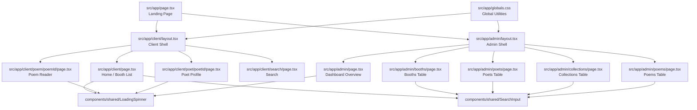

# Design Document: UI Enhancement

## Overview

TelePoem is a poetry kiosk application built with Next.js 16, React 19, TypeScript, and Tailwind CSS. The current UI is functional but visually minimal — plain white cards, basic indigo accents, and no strong visual hierarchy beyond font sizes. This enhancement transforms both the public client/kiosk experience and the admin dashboard into polished, visually cohesive interfaces while preserving all existing functionality and component contracts.

The design philosophy is "literary elegance meets modern SaaS": the client/kiosk side leans into warm, poetic aesthetics (rich gradients, generous whitespace, serif-inspired typography treatment) while the admin side adopts a clean, professional dashboard look with clear information hierarchy, color-coded stat cards, and improved table ergonomics. All changes are purely presentational — no API contracts, data models, or routing are altered.

The enhancement covers ten areas: the landing page, client layout/header, client home page, poem reading page, poet profile page, admin layout/sidebar, admin dashboard, admin table pages (booths, poets, collections, poems), shared components (LoadingSpinner, empty states, SearchInput), and global CSS utilities.

## Architecture

The UI layer is a standard Next.js App Router structure. All changes are confined to the presentation layer — no new routes, API calls, or state management changes are introduced.



## Visual Design System

### Color Palette

The existing indigo primary is retained and extended with a richer palette:

| Token | Value | Usage |
|---|---|---|
| `--primary` | `#4f46e5` (indigo-600) | Primary actions, active states |
| `--primary-light` | `#eef2ff` (indigo-50) | Backgrounds, badges |
| `--accent-warm` | `#f59e0b` (amber-500) | Highlights, poem numbers |
| `--accent-emerald` | `#10b981` (emerald-500) | Active/success states |
| `--surface` | `#ffffff` | Card backgrounds |
| `--surface-muted` | `#f8fafc` (slate-50) | Page backgrounds |
| `--text-primary` | `#0f172a` (slate-900) | Headings |
| `--text-secondary` | `#475569` (slate-600) | Body text |
| `--text-muted` | `#94a3b8` (slate-400) | Placeholders, metadata |
| `--border` | `#e2e8f0` (slate-200) | Card/table borders |

### Typography Scale

| Role | Classes | Usage |
|---|---|---|
| Hero heading | `text-5xl font-bold tracking-tight` | Landing page H1 |
| Page heading | `text-3xl font-bold tracking-tight` | Section titles |
| Card heading | `text-xl font-semibold` | Card titles |
| Body | `text-base leading-relaxed` | General prose |
| Poetry text | `text-lg leading-[1.9] font-light` | Poem body (`.poetry-text`) |
| Caption | `text-xs text-slate-500` | Metadata, counts |

### Spacing & Shape

- Cards: `rounded-2xl` (up from `rounded-xl`) with `shadow-sm hover:shadow-md` transitions
- Buttons: `rounded-lg` with `transition-all duration-150`
- Sidebar: `rounded-2xl` with subtle `ring-1 ring-slate-200`
- Tables: `rounded-xl` wrapper, `bg-slate-50` header rows

---

## Components and Interfaces

### 1. Landing Page (`src/app/page.tsx`)

**Purpose**: First impression — routes users to either the kiosk or admin experience.

**Current state**: Plain centered layout, two white cards, no visual differentiation.

**Enhanced design**:
- Full-viewport hero with a light layered gradient background (`from-indigo-50 via-violet-50 to-slate-50`)
- Animated decorative elements (subtle floating circles via CSS keyframes)
- Large centered wordmark with a tagline in indigo-900
- Two entry-point cards with distinct visual identities: kiosk card uses warm amber accent ring, admin card uses slate/neutral ring
- Cards have white backgrounds with subtle shadows and hover lift effects

**Interface** (no prop changes — this is a server component):
```typescript
// No interface changes. Pure visual enhancement.
export default function Home(): JSX.Element
```

**Visual structure**:
```
┌─────────────────────────────────────────────┐
│  [gradient bg: indigo-50 → slate-50]         │
│                                              │
│         ✦  TelePoem  ✦                       │
│    A poetry kiosk experience                 │
│                                              │
│  ┌──────────────┐  ┌──────────────┐          │
│  │  🎭 TelePoem │  │  ⚙ Admin     │          │
│  │  Public kiosk│  │  Dashboard   │          │
│  │  [amber ring]│  │  [slate ring]│          │
│  └──────────────┘  └──────────────┘          │
└─────────────────────────────────────────────┘
```

---

### 2. Client Layout & Header (`src/app/client/layout.tsx`)

**Purpose**: Persistent shell for all public-facing kiosk pages.

**Current state**: Basic white header, plain text nav links, no active state.

**Enhanced design**:
- Header uses `bg-white/95 backdrop-blur-md` with a stronger bottom border
- Brand logo area with a small decorative icon (📜 or SVG quill) beside "TelePoem"
- Nav links use `usePathname()` for active highlighting: active link gets `text-indigo-700 font-semibold border-b-2 border-indigo-600`
- Smooth underline transition on hover for inactive links
- Background: richer gradient `from-slate-50 via-indigo-50/30 to-white`

**Interface**:
```typescript
// layout.tsx must become a Client Component to use usePathname
"use client";

interface ClientLayoutProps {
  children: React.ReactNode;
}

export default function TelegramLayout({ children }: ClientLayoutProps): JSX.Element
```

**Nav link active state logic**:
```typescript
interface NavLink {
  href: string;
  label: string;
  icon?: React.ReactNode;
}

const links: NavLink[] = [
  { href: "/client", label: "Home" },
  { href: "/client/poets", label: "Poets" },
  { href: "/client/search", label: "Search" },
];

// Active detection: exact match for /client, startsWith for others
function isActive(pathname: string, href: string): boolean {
  if (href === "/client") return pathname === "/client";
  return pathname.startsWith(href);
}
```

---

### 3. Client Home Page (`src/app/client/page.tsx`)

**Purpose**: Booth selection and poet discovery for kiosk users.

**Current state**: Plain grid of white cards with minimal differentiation.

**Enhanced design**:

**Booth cards**:
- Gradient accent bar at top of each card (indigo-to-violet, 4px height)
- Location icon (📍 or SVG pin) beside the location name
- Theme displayed as a styled tag/badge
- Collection count with a book icon
- Hover: `hover:-translate-y-1 hover:shadow-lg` with `transition-all duration-200`

**Poet cards**:
- Avatar circle with gradient background (`from-indigo-400 to-violet-500`) for initial letter
- Poem count badge with amber accent
- Bio text with proper `line-clamp-2`
- Subtle left border accent on hover

**Section headers**: Decorative divider line with centered text for "Select Booth" and "Featured Poets"

---

### 4. Poem Reading Page (`src/app/client/poem/[poemId]/page.tsx`)

**Purpose**: The core reading experience — must feel immersive and literary.

**Current state**: Functional but plain; poem text in a white card, basic prev/next buttons.

**Enhanced design**:
- Full-width article card with a warm off-white background (`bg-amber-50/30`) and a subtle paper texture via CSS
- Poem title in a larger, more dramatic size (`text-4xl font-bold`)
- Poet name as a styled byline with a decorative em-dash prefix
- Poem text uses `.poetry-text` class (enhanced in globals.css): `font-light text-lg leading-[1.9] text-slate-800`
- Decorative opening quote mark (large, faded indigo `"`) as a CSS pseudo-element
- Progress indicator (`3 / 12`) styled as a pill badge
- Prev/Next navigation: full-styled buttons with chevron icons, disabled state uses `opacity-40 cursor-not-allowed`
- Audio player: custom-styled wrapper with a waveform icon and "Listen" label

**Poem article visual**:
```
┌─────────────────────────────────────────────┐
│  ← Back          [3 / 12]                   │
│                                              │
│  ❝                                           │
│  The Road Not Taken                          │
│  — Robert Frost                              │
│                                              │
│  Two roads diverged in a yellow wood,        │
│  And sorry I could not travel both...        │
│                                              │
│  [🎵 Listen to this poem ▶]                  │
│                                              │
│  [← Previous]              [Next →]          │
└─────────────────────────────────────────────┘
```

---

### 5. Poet Profile Page (`src/app/client/poet/[poetId]/page.tsx`)

**Purpose**: Showcase a poet and their works.

**Current state**: Basic profile card, plain poem list.

**Enhanced design**:
- Profile header: gradient banner (`from-indigo-600 to-violet-700`) with the avatar overlapping the bottom edge
- Avatar: larger (112×112px), white ring border (`ring-4 ring-white`), gradient fallback for initial
- Poet name in white on the gradient banner
- Bio in a clean card below the banner
- Poem list: two-column grid of styled cards with poem number badge (amber), title, collection tag, and listen button
- "Back to poets" link styled as a breadcrumb

---

### 6. Admin Layout (`src/app/admin/layout.tsx`)

**Purpose**: Persistent sidebar navigation for admin pages.

**Current state**: Basic sidebar with plain text links, no active state.

**Enhanced design**:
- Sidebar becomes a Client Component to use `usePathname()`
- Active nav item: `bg-indigo-50 text-indigo-700 font-semibold` with a left border accent (`border-l-2 border-indigo-600`)
- Inactive items: `text-slate-600 hover:bg-slate-50 hover:text-slate-900`
- Sidebar header: "TelePoem Admin" with a small admin icon, separated by a divider
- Each nav item has a small icon (SVG) beside the label
- Sidebar background: `bg-white` with `ring-1 ring-slate-200 shadow-sm`
- Main content area: `bg-slate-50` page background

**Nav items with icons**:
```typescript
interface AdminNavLink {
  href: string;
  label: string;
  icon: React.ReactNode; // SVG icon component
  exact?: boolean;       // exact match for /admin overview
}

const links: AdminNavLink[] = [
  { href: "/admin", label: "Overview", icon: <GridIcon />, exact: true },
  { href: "/admin/booths", label: "Booths", icon: <MapPinIcon /> },
  { href: "/admin/collections", label: "Collections", icon: <BookOpenIcon /> },
  { href: "/admin/poets", label: "Poets", icon: <UserIcon /> },
  { href: "/admin/poems", label: "Poems", icon: <DocumentTextIcon /> },
];
```

---

### 7. Admin Dashboard (`src/app/admin/page.tsx`)

**Purpose**: At-a-glance overview of content counts with quick-action links.

**Current state**: Four identical white stat cards, plain indigo action buttons.

**Enhanced design**:

**Stat cards** — each with a unique color identity:
| Stat | Icon | Color scheme |
|---|---|---|
| Booths | 📍 MapPin | Indigo (`bg-indigo-50`, `text-indigo-700`) |
| Collections | 📚 BookOpen | Violet (`bg-violet-50`, `text-violet-700`) |
| Poems | 📄 DocumentText | Amber (`bg-amber-50`, `text-amber-700`) |
| Poets | 👤 User | Emerald (`bg-emerald-50`, `text-emerald-700`) |

Each card:
- Icon in a colored circle (48×48px)
- Large count number (`text-4xl font-bold`)
- Label and a subtle "View all →" link
- Hover lift effect

**Quick actions**: Styled as a row of outlined buttons with `+` icons, each color-matched to its stat card.

---

### 8. Admin Table Pages

**Purpose**: CRUD management for booths, poets, collections, and poems.

**Current state**: Functional tables with minimal styling, plain action buttons.

**Enhanced design** (applied consistently across all four table pages):

**Table wrapper**: `rounded-2xl border bg-white shadow-sm overflow-hidden`

**Table header row**: `bg-slate-50 border-b border-slate-200` with `text-xs font-semibold uppercase tracking-wide text-slate-500`

**Table body rows**:
- Alternating subtle background: `even:bg-slate-50/50`
- Hover: `hover:bg-indigo-50/30 transition-colors`
- Border: `border-b border-slate-100 last:border-0`

**Action buttons** (standardized):
```typescript
// Edit button
"rounded-md bg-indigo-50 px-3 py-1.5 text-xs font-medium text-indigo-700 
 hover:bg-indigo-100 border border-indigo-200 transition-colors"

// Delete button  
"rounded-md bg-red-50 px-3 py-1.5 text-xs font-medium text-red-700 
 hover:bg-red-100 border border-red-200 transition-colors"

// Neutral/secondary button (Manage, Toggle)
"rounded-md bg-slate-50 px-3 py-1.5 text-xs font-medium text-slate-700 
 hover:bg-slate-100 border border-slate-200 transition-colors"
```

**Page header**: Consistent pattern across all table pages:
```
┌─────────────────────────────────────────────┐
│  Booth Management          [+ Create Booth]  │
│  ─────────────────────────────────────────  │
│  [🔍 Filter by location, theme, or status…] │
└─────────────────────────────────────────────┘
```

---

### 9. Shared Components

#### LoadingSpinner (`src/components/shared/LoadingSpinner.tsx`)

**Enhanced interface**:
```typescript
interface LoadingSpinnerProps {
  /** "inline" = small inline spinner (default), "page" = full-page centered overlay */
  variant?: "inline" | "page";
  /** Optional label shown below the spinner in page variant */
  label?: string;
}

export const LoadingSpinner: React.FC<LoadingSpinnerProps>
```

**Inline variant** (existing behavior, slightly larger spinner):
```
⟳ Loading...
```

**Page variant** (new):
```
┌─────────────────────────────────────────────┐
│                                              │
│                   ⟳                          │
│              Loading...                      │
│                                              │
└─────────────────────────────────────────────┘
```
Uses `fixed inset-0 flex flex-col items-center justify-center bg-white/80 backdrop-blur-sm z-40`

#### Empty States

A new `EmptyState` component for consistent empty-list messaging:

```typescript
interface EmptyStateProps {
  icon?: React.ReactNode;   // SVG icon, defaults to inbox/document icon
  title: string;            // e.g. "No booths found"
  description?: string;     // e.g. "Create one to get started."
  action?: React.ReactNode; // Optional CTA button
}

export const EmptyState: React.FC<EmptyStateProps>
```

Visual:
```
┌─────────────────────────────────────────────┐
│                                              │
│              [icon: 48×48px]                 │
│           No booths found                    │
│      Create one to get started.              │
│                                              │
│           [+ Create Booth]  ← optional       │
└─────────────────────────────────────────────┘
```

#### SearchInput (`src/components/shared/SearchInput.tsx`)

**Interface unchanged** — only visual enhancement:
- Slightly taller input (`py-2.5` instead of `py-2`)
- Stronger focus ring: `focus:ring-2 focus:ring-indigo-500 focus:border-indigo-500`
- Subtle background tint when focused: `focus:bg-white`
- Clear button more prominent on hover

---

## Data Models

No data model changes. All types in `src/lib/types.ts` remain unchanged. The UI enhancement is purely presentational.

---

## Algorithmic Pseudocode

### Active Nav Link Detection

```pascal
FUNCTION isActiveLink(pathname: string, href: string, exact: boolean): boolean
  INPUT: pathname (current URL path), href (nav link target), exact (require exact match)
  OUTPUT: boolean indicating active state

  IF exact = true THEN
    RETURN pathname = href
  ELSE
    RETURN pathname STARTS_WITH href
  END IF
END FUNCTION
```

**Preconditions:**
- `pathname` is a valid URL path string (non-empty, starts with `/`)
- `href` is a valid URL path string

**Postconditions:**
- Returns `true` if and only if the link should be styled as active
- For exact=true: only the exact path matches
- For exact=false: any sub-path also matches (e.g. `/admin/booths/123` matches `/admin/booths`)

### LoadingSpinner Variant Rendering

```pascal
FUNCTION renderLoadingSpinner(variant: "inline" | "page", label: string | undefined): JSX
  INPUT: variant, optional label
  OUTPUT: JSX element

  IF variant = "page" THEN
    RETURN (
      fixed-overlay-container
        spinner-circle (h-10 w-10, border-4)
        IF label IS NOT NULL THEN
          label-text
        END IF
    )
  ELSE
    RETURN (
      inline-container
        spinner-circle (h-4 w-4, border-2)
        "Loading..." text
    )
  END IF
END FUNCTION
```

**Preconditions:**
- `variant` is one of `"inline"` or `"page"`

**Postconditions:**
- Page variant renders a fixed overlay that covers the viewport
- Inline variant renders inline without affecting layout flow
- Both variants use the same spinner animation (`animate-spin`)

---

## Key Functions with Formal Specifications

### `isActive(pathname, href)` — Client Layout & Admin Layout

```typescript
function isActive(pathname: string, href: string, exact = false): boolean
```

**Preconditions:**
- `pathname` is the current Next.js `usePathname()` value (non-null string)
- `href` is a valid internal route string

**Postconditions:**
- Returns `true` iff the nav link should receive active styling
- Does not mutate any arguments
- Deterministic: same inputs always produce same output

### `LoadingSpinner({ variant, label })` — Shared Component

```typescript
function LoadingSpinner({ variant = "inline", label }: LoadingSpinnerProps): JSX.Element
```

**Preconditions:**
- `variant` defaults to `"inline"` if not provided

**Postconditions:**
- `"page"` variant: renders a `fixed` overlay with `z-40`, centered spinner and optional label
- `"inline"` variant: renders an inline flex container with small spinner and "Loading..." text
- No side effects

---

## Example Usage

### Using the page-variant LoadingSpinner

```typescript
// In a page component that fetches data
if (loading) return <LoadingSpinner variant="page" label="Loading poems…" />;
```

### Using the EmptyState component

```typescript
// In admin table pages
{!loading && filteredBooths.length === 0 && (
  <EmptyState
    icon={<MapPinIcon className="h-12 w-12 text-slate-300" />}
    title={searchQuery ? `No booths match "${searchQuery}"` : "No booths yet"}
    description={!searchQuery ? "Create your first booth to get started." : undefined}
    action={
      !searchQuery ? (
        <button onClick={openCreate} className="btn-primary">
          + Create Booth
        </button>
      ) : undefined
    }
  />
)}
```

### Active nav link in admin sidebar

```typescript
// In AdminSidebar (client component)
const pathname = usePathname();

{links.map((link) => (
  <Link
    key={link.href}
    href={link.href}
    className={cn(
      "flex items-center gap-2.5 rounded-lg px-3 py-2 text-sm transition-colors",
      isActive(pathname, link.href, link.exact)
        ? "border-l-2 border-indigo-600 bg-indigo-50 pl-[10px] font-semibold text-indigo-700"
        : "text-slate-600 hover:bg-slate-50 hover:text-slate-900"
    )}
  >
    {link.icon}
    {link.label}
  </Link>
))}
```

---

## Correctness Properties

*A property is a characteristic or behavior that should hold true across all valid executions of a system — essentially, a formal statement about what the system should do. Properties serve as the bridge between human-readable specifications and machine-verifiable correctness guarantees.*

### Property 1: `isActive` exact-match correctness

For any pathname string, `isActive(pathname, href, exact=true)` returns `true` if and only if `pathname === href`, and `false` for all other pathnames.

**Validates: Requirements 2.3, 6.3**

### Property 2: `isActive` prefix-match correctness

For any pathname string and any href string, `isActive(pathname, href, exact=false)` returns `true` if and only if `pathname.startsWith(href)`.

**Validates: Requirements 2.4, 6.4**

### Property 3: Poet initial-letter avatar

For any poet object where `image` is null or undefined, the rendered avatar element contains the first character of `poet.name` (uppercased) as its text content.

**Validates: Requirements 3.5, 5.3**

### Property 4: Poem byline contains poet name with em-dash

For any poem object where `poet` is non-null, the rendered byline element contains the string `— {poet.name}`.

**Validates: Requirements 4.3**

### Property 5: Progress indicator displays correct index and total

For any poem with a computed `index` and `total`, the rendered progress indicator contains the string `{index} / {total}` (or equivalent formatting).

**Validates: Requirements 4.6**

### Property 6: Navigation button disabled state

For any poem where `prevId` is null, the Previous button has the `opacity-40` and `cursor-not-allowed` classes; for any poem where `nextId` is null, the Next button has those same classes.

**Validates: Requirements 4.7, 4.8**

### Property 7: Admin stat card color identity

For any of the four stat types (Booths, Collections, Poems, Poets), the rendered stat card contains the CSS classes corresponding to that type's designated color scheme (indigo for Booths, violet for Collections, amber for Poems, emerald for Poets).

**Validates: Requirements 7.1**

### Property 8: LoadingSpinner inline variant renders inline

For any `LoadingSpinner` rendered with `variant="inline"` or with no `variant` prop, the root element does not have the `fixed` CSS class and renders inline without a full-page overlay.

**Validates: Requirements 9.3, 9.8**

### Property 9: LoadingSpinner page variant renders fixed overlay

For any `LoadingSpinner` rendered with `variant="page"`, the root element has the `fixed` CSS class and `inset-0` positioning, covering the full viewport.

**Validates: Requirements 9.4**

### Property 10: LoadingSpinner page variant displays label

For any non-empty label string passed to `LoadingSpinner` with `variant="page"`, the rendered output contains that label string as visible text.

**Validates: Requirements 9.5**

### Property 11: EmptyState always renders its title

For any non-empty title string passed to `EmptyState`, the rendered output contains that title string as visible text.

**Validates: Requirements 10.2**

### Property 12: EmptyState renders description when provided

For any description string passed to `EmptyState`, the rendered output contains that description string as visible text.

**Validates: Requirements 10.4**

### Property 13: EmptyState rendered for zero-length filtered lists

For any Admin_Table_Page with a filtered list of length zero, the `EmptyState` component is rendered; for any filtered list of length greater than zero, `EmptyState` is not rendered.

**Validates: Requirements 10.9, 10.10**

### Property 14: CSS custom properties preserved after globals.css update

For all CSS custom property names defined in the original `:root` block (`--background`, `--foreground`, `--primary`, `--secondary`, `--accent`, `--danger`), those properties remain defined with their original values after the globals.css enhancement.

**Validates: Requirements 12.4**

### Property 15: Enhanced components preserve existing prop interfaces

For all enhanced components (LoadingSpinner, SearchInput, EmptyState, and all enhanced page components), every prop that was valid before the enhancement remains valid after — no previously-accepted props are removed or made incompatible.

**Validates: Requirements 13.1**

---

## Error Handling

### Error Scenario 1: Missing `usePathname` in layout

**Condition**: `AdminLayout` or `ClientLayout` is used as a Server Component (no `"use client"` directive) but calls `usePathname()`.

**Response**: Next.js will throw a build/runtime error.

**Mitigation**: Both layout files that use `usePathname()` must have `"use client"` at the top. The children (page components) remain server-renderable.

### Error Scenario 2: EmptyState rendered without required props

**Condition**: `EmptyState` is called without a `title` prop.

**Response**: TypeScript compile error (title is required in the interface).

**Mitigation**: `title` is a required prop; `icon`, `description`, and `action` are optional.

### Error Scenario 3: CSS animation not supported

**Condition**: Browser does not support CSS `@keyframes` animations (very rare).

**Response**: Decorative animations (floating circles on landing page, spinner) degrade gracefully — the spinner circle is still visible, just static.

**Mitigation**: Animations are purely decorative; no functional behavior depends on them.

---

## Testing Strategy

### Unit Testing Approach

Test the `isActive` utility function exhaustively:

```typescript
describe("isActive", () => {
  it("exact match: returns true only for exact path", () => {
    expect(isActive("/admin", "/admin", true)).toBe(true);
    expect(isActive("/admin/booths", "/admin", true)).toBe(false);
  });

  it("prefix match: returns true for path and sub-paths", () => {
    expect(isActive("/admin/booths", "/admin/booths", false)).toBe(true);
    expect(isActive("/admin/booths/123", "/admin/booths", false)).toBe(true);
    expect(isActive("/admin/poets", "/admin/booths", false)).toBe(false);
  });
});
```

Test `LoadingSpinner` renders correct variant:

```typescript
describe("LoadingSpinner", () => {
  it("renders inline variant by default", () => {
    render(<LoadingSpinner />);
    expect(screen.queryByRole("status")).not.toHaveClass("fixed");
  });

  it("renders page variant with fixed positioning class", () => {
    const { container } = render(<LoadingSpinner variant="page" />);
    expect(container.firstChild).toHaveClass("fixed");
  });

  it("renders optional label in page variant", () => {
    render(<LoadingSpinner variant="page" label="Loading poems…" />);
    expect(screen.getByText("Loading poems…")).toBeInTheDocument();
  });
});
```

### Property-Based Testing Approach

**Property Test Library**: fast-check

```typescript
import fc from "fast-check";

// Property: isActive is deterministic
fc.assert(
  fc.property(
    fc.webPath(), // arbitrary URL paths
    fc.webPath(),
    fc.boolean(),
    (pathname, href, exact) => {
      const result1 = isActive(pathname, href, exact);
      const result2 = isActive(pathname, href, exact);
      return result1 === result2; // same inputs → same output
    }
  )
);

// Property: EmptyState always renders title
fc.assert(
  fc.property(
    fc.string({ minLength: 1 }),
    fc.option(fc.string()),
    (title, description) => {
      const { getByText } = render(
        <EmptyState title={title} description={description ?? undefined} />
      );
      return !!getByText(title);
    }
  )
);
```

### Integration Testing Approach

Visual regression testing is recommended using Storybook + Chromatic or Playwright visual comparisons:

1. **Landing page**: Verify gradient renders, both entry cards visible
2. **Client layout**: Verify active nav link highlights on each route
3. **Admin layout**: Verify active sidebar item on each admin route
4. **Admin dashboard**: Verify all four stat cards render with correct colors
5. **Table pages**: Verify empty state renders when no data, table renders when data present

---

## Performance Considerations

- All visual enhancements use Tailwind utility classes — no runtime CSS-in-JS overhead
- Gradient backgrounds and `backdrop-blur` are GPU-accelerated in modern browsers
- The `"use client"` directive added to layout files is minimal — only the layout shell re-renders on navigation, not the page content
- CSS animations (`animate-spin`, custom keyframes) use `transform` and `opacity` — compositor-only properties that don't trigger layout reflow
- The new `EmptyState` component is a lightweight functional component with no state or effects
- `LoadingSpinner` page variant uses `fixed` positioning — no layout impact on document flow

---

## Security Considerations

- No new user inputs are introduced by this enhancement
- No new API calls or data fetching
- The `"use client"` additions to layout files do not expose any server-side data
- Decorative SVG icons are inline — no external image requests
- CSS custom properties (`--primary`, etc.) are defined in `:root` — no injection risk

---

## Dependencies

No new npm dependencies are required. All enhancements use:

- **Tailwind CSS** (already installed) — utility classes for all styling
- **Next.js `usePathname`** (already available via `next/navigation`) — for active nav detection
- **React** (already installed) — for the new `EmptyState` component
- **Existing project utilities** — `cn()` helper if available, otherwise inline template literals

The only new file additions are:
- `src/components/shared/EmptyState.tsx` — new shared component
- Updates to `src/components/shared/LoadingSpinner.tsx` — add `variant` prop
- Updates to `src/app/globals.css` — enhanced `.poetry-text`, new `.btn-primary`, animation keyframes
